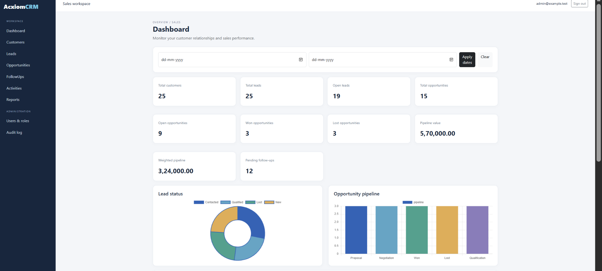
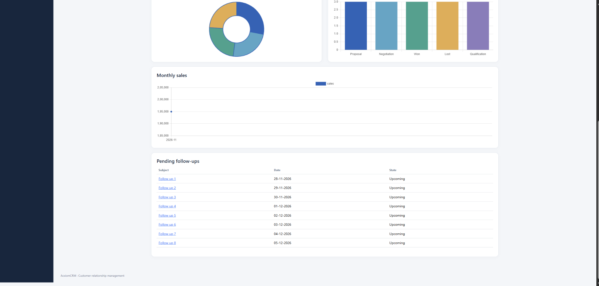
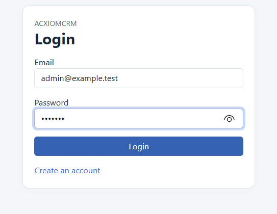
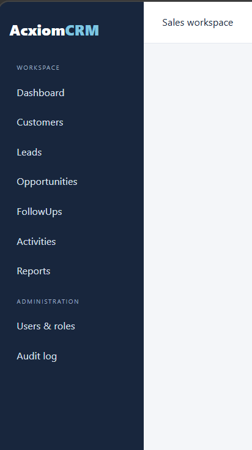

# AcxiomCRM

AcxiomCRM is a sales CRM I built for a college hackathon. It brings customers, leads, opportunities, and follow-ups into one workspace. The main workflow starts with qualifying a lead and continues with conversion, tracking the deal, and scheduling the next conversation.



The dashboard shows counts, open and weighted pipeline, and lead status. The date filters let you choose a reporting range. The numbers in the screenshots come from local demo data.



## What you can do

- **Customers and leads** — Search contacts, assign leads, track qualification, and convert qualified leads.
- **Opportunities** — Track deal stages, amounts, probability, and expected close dates. Weighted pipeline uses deal amount × (probability ÷ 100).
- **Follow-ups and activities** — Schedule the next contact and log calls, meetings, emails, and tasks.
- **Reports** — Browse CRM records and export filtered reports as CSV. The available views depend on your role.
- **Administration** — Manage users and roles and review audit events.

The screenshots below show the sign-in screen and the navigation available to an administrator.

| Sign-in | Admin navigation |
| --- | --- |
|  |  |

## Roles

| Role | Access |
| --- | --- |
| Admin | CRM records across teams, plus user administration and audit logs |
| Manager | Their own and their team's records, pipeline, and reports |
| Sales Executive | Their own assigned CRM records |

## Run locally on Windows

Install the **.NET 10 SDK** and **SQL Server Express LocalDB**. The project uses the `MSSQLLocalDB` instance by default. On the first run, NuGet restore and the UI assets served from CDNs require an internet connection.

Open PowerShell in the folder that contains `AcxiomCRM.sln` and `setup.ps1`, then run:

```powershell
Unblock-File -LiteralPath ".\.config\dotnet-tools.json"
powershell -ExecutionPolicy Bypass -File .\setup.ps1
```

Setup restores the app and the EF Core tool, builds the project, trusts the local HTTPS certificate, and prepares the database. If the migration files are absent, setup generates the initial migration. When prompted, choose a local demo password of at least eight characters with uppercase and lowercase letters, a digit, and a symbol.

Leave PowerShell open and visit [https://localhost:7240](https://localhost:7240), or use the HTTPS URL printed in the terminal.

| Demo account | Email |
| --- | --- |
| Admin | `admin@example.test` |
| Manager | `manager1@example.test` or `manager2@example.test` |
| Sales Executive | `sales1@example.test` or `sales2@example.test` |

On a fresh local database, the demo accounts use the password chosen during setup. Existing accounts keep their passwords. The password is saved in local .NET user secrets.

After setup, start the app again with:

```powershell
dotnet run --project .\AcxiomCRM
```

## Quick demo

1. Sign in as a sales executive and open **Leads**. Pick an assigned lead with a positive expected value. Move it from **New** to **Contacted**, then to **Qualified**.
2. Use **Convert** on the Leads page. Search for the resulting record in **Customers** and **Opportunities**.
3. Open **FollowUps** and schedule the next contact against the new customer. Check that it appears in the list.
4. Sign in as the manager for that sales executive and review the team's **Dashboard** and **Reports**. Finish by showing **Users & roles** and **Audit log** as the admin.

## Project structure and tests

The app uses **ASP.NET Core MVC**, **Razor**, **Bootstrap**, and **Chart.js**. **EF Core** handles SQL Server data access, and **ASP.NET Core Identity** handles sign-in and roles. Controllers and views are under `AcxiomCRM/`. Shared business rules and record scoping live in `AcxiomCRM/Services/`.

Stop the running app with **Ctrl+C** before rebuilding and testing on Windows.

```powershell
dotnet test .\AcxiomCRM.sln
```

The test project covers lead status transitions and customer and opportunity validation rules. For manual checks and API details, see [Testing](docs/TESTING.md) and [API](docs/API.md). Swagger is available at `/swagger` in Development.
