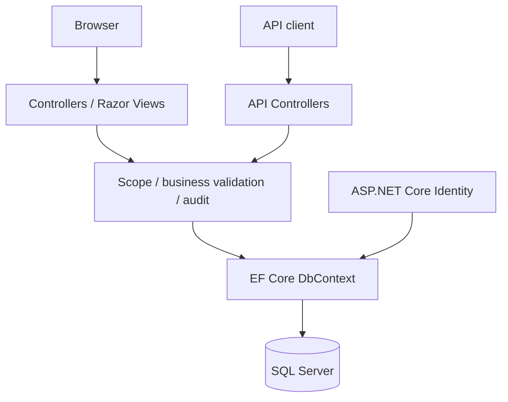

# Architecture

Identity validates credentials and generates session cookies. Controllers use explicit input models and scoped EF queries to prevent unauthorized records being returned. Audit changes are recorded alongside CRM writes.
