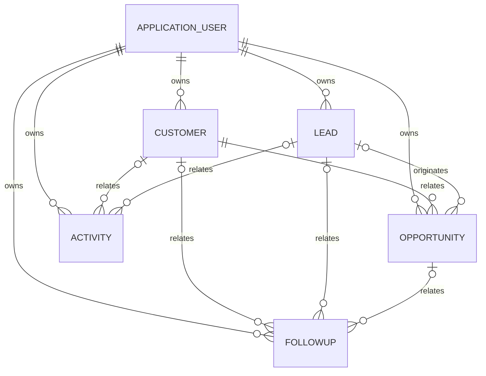

# Database

EF Core creates SQL Server tables, foreign keys and indexes via local migrations. Identity manages password hashes and role tables. Soft deletion preserves referenced records. Customer normalized email and phone have unique indexes.
